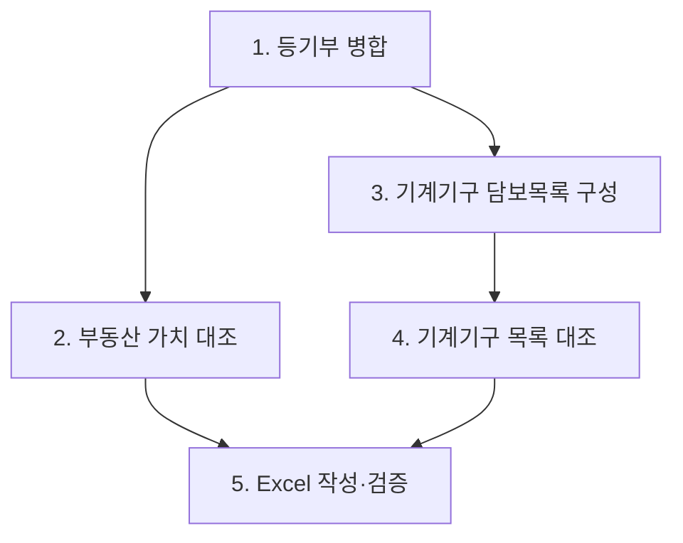

# 담보물 배분표 단계별 LLM 파이프라인 및 Excel Tool-Call 구현 지침서

## 0. 문서 목적

이 문서는 기존 세 문서가 정의한 데이터 의미와 Excel 형식을 실제 시스템 구성요소로 분리하기 위한 상위 구현 지침이다.

- `01_엑셀_구조도_설명서.md`: 최종 Excel의 모양과 동적 구조
- `02_JSON에서_엑셀생성_LLM_지침서.md`: 문서 JSON 간 의미 대조 원칙
- `03_결과_엑셀_작성_지침서.md`: 확정 데이터를 셀에 기록하는 규칙
- 이 문서: 각 단계를 누가 수행하고, 어떤 중간 JSON을 만들며, 어느 시점에 어떤 Excel tool을 호출하는지 정의

최우선 목표는 비용이나 호출 횟수 최소화가 아니라 정확도, 재현성, 검토 가능성이다.

---

# 1. 핵심 설계 결론

## 1.1 LLM과 코드의 책임 분리

| 작업 | 수행 주체 | 이유 |
| --- | --- | --- |
| 입력 파일 연결, 형식 검사 | 코드 | 정확한 ID·개수 비교 문제 |
| 등기부 병합·정렬 | 코드 | 동일성·순서·금액 보존 문제 |
| 부동산과 감정평가 항목의 의미 대조 | 고성능 LLM | 주소 축약, 다필지, 건물 표현 차이 해석 필요 |
| 부동산 가치평가액 합산 | 코드 | LLM 산술 및 중복 합산 방지 |
| 기계기구 담보설정 목록 작성 | 코드 | 을구의 순위·목록번호를 그대로 보존하는 작업 |
| 기계기구와 저당목록 항목 대조 | 고성능 LLM | 반복 명칭, 규격, 제작자, 수량을 종합 판단해야 함 |
| `O/X/공란` 변환과 합계 계산 | 코드 | 판단 상태의 일관성 보장 |
| Excel 행·열·병합·서식·저장 | Excel tool | 같은 입력이면 같은 파일을 만드는 결정론적 작업 |

LLM은 원문 금액을 새로 작성하거나 합계를 직접 확정하지 않는다. LLM은 원본에 미리 부여된 ID 사이의 관계만 반환한다. 금액·수량·합계는 코드가 해당 ID의 원본 값을 다시 조회하여 계산한다.

## 1.2 수정된 실행 의존성

사용자가 제안한 1번 이후 2번과 3번의 병렬화는 가능하다. 다만 4번은 2번 결과가 아니라 3번 결과에만 의존한다.



정확한 실행 형태는 다음과 같다.

```text
1 → (2, 3 병렬)
3 → 4
(2, 4 완료) → 5
```

4번 내부에서는 저당목록 번호별 대조 작업을 서로 병렬 실행할 수 있다. 반면 하나의 워크북에 쓰는 Excel tool 호출은 행 커서와 병합 영역을 공유하므로 순차 실행한다.

---

# 2. 전체 산출물 구조

한 실행은 임시 대화나 폴더 탐색 결과가 아니라 명시적인 `run_manifest.json`에서 시작한다.

```text
run_manifest.json
    ↓
01_registry_merge/
    merged_title.json
    merged_encumbrance.json
    merge_validation.json
    ↓
02_real_estate/
    real_estate_match_decisions.json
    real_estate_match_verification.json
    real_estate_table_plan.json
    ↓
03_machinery_base/
    machinery_distribution_base.json
    ↓
04_machinery_match/
    list_match_{목록번호}.json
    machinery_match_verification.json
    machinery_table_plan.json
    ↓
05_excel/
    workbook_validation.json
    담보물배분표.xlsx
```

각 단계는 이전 단계의 원본 파일을 임의로 다시 탐색하지 않는다. manifest와 직전 단계의 확정 산출물만 사용한다.

---

# 3. 실행 Manifest

## 3.1 목적

작업 폴더 전체를 재귀 탐색하면 같은 `registry_id`의 구버전과 신버전이 함께 선택될 수 있다. 따라서 실행마다 사용할 파일을 명시한다.

```json
{
  "run_id": "human_heavy_2026_08_03_001",
  "borrower_name": "휴먼중공업 주식회사",
  "registries": [
    {
      "title_path": ".../registry_01/title.json",
      "encumbrance_path": ".../registry_01/encumbrance.json"
    }
  ],
  "real_estate_appraisal_path": ".../토지_건물_감정평가명세표.json",
  "machinery_appraisal_path": ".../기계기구_감정평가명세표.json",
  "mortgage_lists": [
    {
      "mortgage_list_no": "공장 및 광업재단 저당법 제6조 목록 제2012-399호",
      "path": ".../2012-399.json"
    }
  ],
  "output_path": ".../담보물배분표.xlsx"
}
```

## 3.2 시작 전 중단 조건

- title과 encumbrance의 내부 `registry_id`가 다름
- 같은 `registry_id`가 둘 이상 존재
- manifest에 같은 저당목록 번호가 둘 이상 존재
- 필수 JSON을 읽을 수 없음
- JSON 스키마가 기대 형식과 다름
- 감정평가 금액·수량이 숫자 또는 `null`이 아님

이 단계의 오류는 LLM에 전달해 교정시키지 않는다. 실행을 `invalid`로 종료한다.

---

# 4. 단계 1 — 등기부 데이터 병합

## 4.1 목표

여러 `title.json`과 `encumbrance.json`을 `registry_id`로 정확히 연결하고, 담보설정현황이 완전히 같은 등기부를 하나의 출력 그룹으로 만든다.

이 단계는 LLM API를 사용하지 않는다.

## 4.2 동일 담보설정현황 판정

각 mortgage를 다음 정규화 튜플로 표현한다.

```text
(registration, maximum_claim, mortgagee, shared_collateral, mortgage_list_no)
```

- 날짜는 비교용 ISO 날짜로 변환한다.
- 금액은 비교용 정수로 변환한다.
- `공용담보`, `공동담보`, `공담`은 비교용 `공담`으로 정규화한다.
- 목록번호는 공백 차이만 정리하고 숫자와 전체 식별자는 보존한다.
- 같은 날짜 항목은 원본 배열 순서를 유지한다.
- 전체 튜플 배열의 항목 수, 값, 순서가 모두 같을 때만 같은 그룹이다.

같은 날짜 항목의 순서가 서로 다르면 자동 병합하지 않는다. 순위와 배분내역의 1:1 대응이 달라질 수 있으므로 `review_required`로 보낸다.

## 4.3 `merged_title.json`

```json
{
  "run_id": "human_heavy_2026_08_03_001",
  "status": "ok",
  "groups": [
    {
      "group_id": "group_01",
      "registry_ids": ["registry_01", "registry_03"],
      "properties": [
        {
          "property_id": "registry_01:title",
          "registry_id": "registry_01",
          "property_type": "토지",
          "location": "경상남도 함안군 칠서면 계내리 12",
          "details": "공장용지 10934㎡",
          "source_path": ".../title.json"
        }
      ]
    }
  ],
  "review_required": [],
  "blocking_errors": []
}
```

## 4.4 `merged_encumbrance.json`

```json
{
  "run_id": "human_heavy_2026_08_03_001",
  "status": "ok",
  "groups": [
    {
      "group_id": "group_01",
      "registry_ids": ["registry_01", "registry_03"],
      "mortgages": [
        {
          "mortgage_id": "group_01:mortgage_01",
          "rank": 1,
          "registration": "2012-08-20",
          "maximum_claim": 5040000000,
          "mortgagee": "중소기업은행",
          "shared_collateral": "공담",
          "mortgage_list_no": "공장 및 광업재단 저당법 제6조 목록 제2012-399호",
          "source_order": 1
        }
      ]
    }
  ],
  "review_required": [],
  "blocking_errors": []
}
```

두 파일의 `group_id`와 `registry_ids`는 반드시 동일해야 한다. `group_id`는 최초 registry 순서에 따라 결정론적으로 부여한다.

## 4.5 검증 게이트

- 모든 registry가 정확히 한 그룹에만 속함
- 같은 그룹의 title·encumbrance `registry_ids`가 일치함
- 순위가 1부터 연속적임
- 날짜순 안정 정렬이 보존됨
- 금액 정수화 전후 값이 동일함
- manifest에 없는 registry가 생성되지 않음

---

# 5. 단계 2 — 부동산 가치평가액 대조

## 5.1 목표

`merged_title.json`의 부동산 그룹과 토지·건물 감정평가 JSON의 평가 그룹을 의미적으로 연결한다.

LLM은 **매칭 관계만 결정**한다. LLM이 `total_appraised_value`를 직접 계산하거나 새 금액을 출력하게 하지 않는다.

## 5.2 LLM 입력 준비

코드는 감정평가 그룹에 안정적인 ID를 먼저 부여한다.

```text
land_001, land_002, ...
building_001, building_002, ...
```

LLM에는 다음만 전달한다.

- `merged_title.json`의 그룹·부동산 ID·원문
- 감정평가 그룹 ID·유형·소재지·items 원문
- 한 감정평가 그룹을 둘 이상의 담보 그룹에 배정할 수 없다는 제약
- 행정구역·지번의 명시적 충돌은 자동 교정하지 않는 규칙

## 5.3 LLM 1차 출력

```json
{
  "status": "ok",
  "assignments": [
    {
      "appraisal_group_id": "land_001",
      "target_group_id": "group_01",
      "related_property_ids": ["registry_01:title"],
      "decision": "matched",
      "evidence": [
        "property_type=토지 일치",
        "행정구역 일치",
        "지번 12 일치"
      ],
      "conflicts": []
    }
  ],
  "unassigned_appraisal_group_ids": [],
  "review_required": []
}
```

`decision`은 `matched`, `unmatched`, `unresolved` 중 하나이다. 수치형 confidence만으로 자동 확정하지 않는다. 주소의 핵심 토큰이 충돌하면 confidence가 높더라도 `unresolved`이다.

## 5.4 독립 검증 호출

정확도 우선 운영에서는 1차 매칭 결과를 그대로 사용하지 않는다. 두 번째 LLM 호출은 원본 입력과 1차 assignment를 함께 받고 다음만 판단한다.

- 각 assignment가 원문 근거로 승인 가능한가
- 더 적합한 다른 그룹이 존재하는가
- 중복 배정이나 누락이 있는가
- 하드 충돌이 무시되었는가

검증기는 새 매칭 결과 전체를 자유 생성하지 않고 assignment별 `approved`, `rejected`, `unresolved`와 이유를 반환한다. 1차 판단과 검증 판단이 다르면 코드가 임의 선택하지 않고 `review_required`로 전환한다.

## 5.5 코드의 확정 계산

승인된 `appraisal_group_id`를 원본 감정평가 JSON에서 다시 조회하여 금액을 합산한다.

```text
group_total = sum(승인된 appraisal_group_id의 원본 total_appraised_value)
```

하나의 감정평가 그룹 ID는 전체 실행에서 한 번만 합산할 수 있다. LLM이 반환한 금액 필드는 신뢰하지 않으며, 가능하면 출력 스키마에서 금액 필드 자체를 제거한다.

## 5.6 최종 `real_estate_table_plan.json`

최종 계획에는 다음이 포함된다.

- 담보 그룹과 포함 registry
- 표시할 title 원문
- 날짜순 mortgage 배열
- 승인된 감정평가 그룹 ID와 provenance
- 코드가 계산한 그룹별 가치평가액
- 항상 `null`인 배분액·배분잔액
- `status`, `review_required`, `blocking_errors`

핵심 매칭이 하나라도 `unresolved`이면 `status=review_required`이고 최종 Excel 생성을 막는다.

---

# 6. 단계 3 — 기계기구 담보물 내역 목록 구성

## 6.1 목표

`merged_title.json`과 `merged_encumbrance.json`만으로 기계기구 담보물 배분표의 기반 정보를 만든다.

이 단계는 LLM API를 사용하지 않는다. 감정평가 기계기구의 실제 행·수량·금액은 아직 합치지 않는다.

## 6.2 대상 그룹 선택

각 담보 그룹에 대해 비어 있지 않은 `mortgage_list_no`의 집합을 만든다.

현재 데이터처럼 한 그룹의 목록번호 집합이 다른 후보 그룹의 집합을 모두 포함하는 **유일한 최대 집합**이면 그 그룹을 기계기구 기준 그룹으로 선택한다.

예시:

```text
group_01 = {399, 514, 515, 720, 309, 234}
group_02 = {234}
→ group_01 선택
```

다음 경우에는 자동 선택하지 않는다.

- 서로 포함관계가 없는 최대 집합이 둘 이상임
- 저당목록 JSON에 존재하는 목록번호와 후보 그룹의 목록번호가 충돌함
- 목록번호가 하나도 없음

필요하다면 서로 독립된 기계기구 담보 그룹이 실제로 여러 개인지 사람이 판단해야 한다.

## 6.3 `machinery_distribution_base.json`

```json
{
  "status": "ok",
  "source_group_id": "group_01",
  "registry_ids": ["registry_01", "registry_03"],
  "locations": ["경상남도 함안군 칠서면 계내리 12"],
  "mortgages": [],
  "mortgage_list_numbers": [
    "공장 및 광업재단 저당법 제6조 목록 제2012-399호"
  ],
  "review_required": [],
  "blocking_errors": []
}
```

목록번호 순서는 mortgage 순위 순서를 유지한다. 중복 목록번호가 나오면 자동 제거하기 전에 같은 담보설정의 중복인지 검증한다.

---

# 7. 단계 4 — 기계기구 배분표 및 대조표 확정

## 7.1 목표

감정평가서 기계기구 행을 기준 행으로 유지하면서, 각 저당목록에 같은 기계기구가 포함되는지 판단한다.

목록번호별 대조는 서로 독립적이므로 병렬 호출할 수 있다.

## 7.2 입력 ID 부여

코드는 LLM 호출 전에 모든 항목에 ID를 부여한다.

```text
감정평가 행: machine_001, machine_002, ...
저당목록 항목: list_2012_399:item_001, list_2012_399:item_002, ...
```

LLM은 텍스트를 다시 생성하지 않고 이 ID들의 대응관계를 반환한다.

## 7.3 목록번호별 1차 매칭 출력

```json
{
  "mortgage_list_no": "공장 및 광업재단 저당법 제6조 목록 제2012-399호",
  "source_completeness": "complete",
  "matches": [
    {
      "appraisal_item_id": "machine_001",
      "matched_list_item_ids": ["list_2012_399:item_003"],
      "decision": "matched",
      "covered_quantity": 1,
      "evidence": [
        "명칭 일치",
        "20Ton 및 Span 약 21m 일치",
        "제작자와 제작연월 일치"
      ],
      "conflicts": []
    }
  ],
  "unconsumed_list_item_ids": [],
  "review_required": []
}
```

## 7.4 동일 항목 판정 규칙

명칭만으로 `matched`를 반환하지 않는다. 다음을 종합한다.
1. 명칭
2. 제작자
3. 제작연월
4. 수량
5. 동일 명칭의 문서 내 등장 순서

한 저당목록 항목은 같은 목록 안에서 둘 이상의 감정평가 행을 동시에 충족할 수 없다. 단, 원문 수량이 여러 개인 항목은 그 수량 범위 안에서만 분할 대응할 수 있으며 코드가 소비 수량을 추적한다.


## 7.5 코드의 최종 변환

코드는 승인된 판단을 다음처럼 Excel 상태로 변환한다.

| 확정 판단 | Excel 값 |
| --- | --- |
| `matched` | `O` |
| `그 외` | 공란 |


동시에 감정평가 원본에서 다음을 계산한다.

```text
quantity_total = sum(quantity)
amount_total = sum(amount)
```

`unit_price=null`은 그대로 유지한다. `amount / quantity`로 역산하지 않는다.

## 7.9 `machinery_table_plan.json`

이 파일 하나가 기계기구 배분표와 대조표의 확정 입력이 된다.

- 단계 3의 소재지·mortgage·목록번호
- 감정평가서 기준 기계기구 행
- 코드가 계산한 전체 수량과 전체 금액
- 목록번호별 `O/X/null` 행렬
- 각 셀의 matched list item ID와 근거
- `status`, `review_required`, `blocking_errors`

---

# 8. 모델 배치 원칙

현재 OpenAI 모델 체계에서는 GPT-5.6 Sol이 복잡한 전문 작업용 최상위 모델이고, Terra는 성능·비용 균형, Luna는 대량 단순 작업용이다. 오케스트레이터는 데이터 의미를 다시 판단하지 않는다. 오직 단계 상태를 보고 다음 허용 tool을 호출한다. 애플리케이션 코드가 직접 단계 함수를 호출할 수 있다면 오케스트레이터 LLM 자체를 생략하는 편이 실패 지점이 적다.

---

# 9. Excel Tool-Call 계약

## 9.1 설계 원칙

Agent에게 `write_cell`, `merge_cells`, `set_style` 같은 범용 도구를 주지 않는다. Agent가 행 번호나 병합 범위를 생성하면 동적 표에서 오프셋 오류가 발생할 수 있다.

Agent는 검증 완료된 계획 파일의 경로와 해시만 전달한다. Excel tool이 계획을 다시 읽고 스키마·합계·상태를 검증한 뒤, 구조도 설명서에 따라 셀을 결정론적으로 만든다.

## 9.2 권장 도구 집합

### `excel_start_collateral_workbook`

```json
{
  "run_id": "human_heavy_2026_08_03_001",
  "borrower_name": "휴먼중공업 주식회사",
  "sheet_name": "Sheet1"
}
```

반환값은 `workbook_id`이다. 같은 `run_id`로 재호출하면 새 워크북을 중복 생성하지 않고 기존 실행 상태를 반환한다.

### `excel_add_real_estate_section`

```json
{
  "workbook_id": "wb_human_heavy_2026_08_03_001",
  "plan_path": ".../real_estate_table_plan.json",
  "plan_sha256": "..."
}
```

도구가 확인해야 할 사항:

- plan `status=ok`
- 모든 배분액·배분잔액이 `null`
- 그룹 합계가 승인된 감정평가 ID의 원본 합계와 일치
- 동일 감정평가 ID 중복 사용 없음
- 부동산 영역이 아직 작성되지 않음

### `excel_add_machinery_distribution_section`

```json
{
  "workbook_id": "wb_human_heavy_2026_08_03_001",
  "plan_path": ".../machinery_table_plan.json",
  "plan_sha256": "..."
}
```

도구는 기계기구 배분표만 작성한다. 목록번호는 mortgage 순위 순서를 유지하고, 수량 합계와 감정평가액은 plan의 원본 합계 검증을 통과해야 한다.

### `excel_add_machinery_crosscheck_section`

```json
{
  "workbook_id": "wb_human_heavy_2026_08_03_001",
  "plan_path": ".../machinery_table_plan.json",
  "plan_sha256": "..."
}
```

도구가 확인해야 할 사항:

- 대조표 행 수가 감정평가 행 수와 일치
- 동적 목록 열이 담보설정 목록번호 배열과 일치
- 모든 셀이 `O`, `X`, `null` 중 하나
- `unit_price=null` 행은 단가 공란
- 행 수 합계가 아닌 `sum(quantity)`를 전체 수량으로 사용

### `excel_finalize_collateral_workbook`

```json
{
  "workbook_id": "wb_human_heavy_2026_08_03_001",
  "validation_path": ".../workbook_validation.json",
  "output_path": ".../담보물배분표.xlsx"
}
```

최종 도구는 다음이 모두 충족될 때만 파일을 확정한다.

- 부동산, 기계기구 배분표, 대조표가 각각 한 번 작성됨
- 모든 단계 status가 `ok`
- `review_required`와 `blocking_errors`가 비어 있음
- 셀 병합 충돌 없음
- 수식 오류 없음
- 숫자·날짜가 문자열로 잘못 저장되지 않음
- 렌더 결과에서 잘림·겹침이 없음

## 9.3 도구 실행 순서

```text
excel_start_collateral_workbook
→ excel_add_real_estate_section
→ excel_add_machinery_distribution_section
→ excel_add_machinery_crosscheck_section
→ excel_finalize_collateral_workbook
```

상류의 단계 2와 4는 병렬 처리할 수 있지만, 위 Excel tool은 같은 workbook 상태를 수정하므로 순차 실행한다.

## 9.4 Tool이 가져야 하는 안전장치

- `run_id + section_name`을 idempotency key로 사용
- 동일 섹션의 중복 작성 거부
- 계획 파일 해시가 호출 시점과 다르면 거부
- 임시 파일에서 작성 후 최종 성공 시에만 output path로 확정
- 실패 시 기존 완성 파일을 덮어쓰지 않음
- Agent가 임의 셀 주소·행 번호·스타일 값을 전달할 수 없게 함
- `review_required` 계획은 Excel에 쓰지 않고 오류 보고서만 반환

---

# 10. 단계별 상태와 실패 처리

모든 중간 JSON은 다음 상태 중 하나를 가져야 한다.

| 상태 | 의미 | 다음 단계 |
| --- | --- | --- |
| `ok` | 모든 핵심 판단 확정 | 진행 |
| `review_required` | 원문 충돌·부분 일치·복수 후보 | 최종 Excel 중단 |
| `invalid` | 파일 누락·스키마 오류·합계 불일치 | 즉시 중단 |

오류를 다음 LLM이 추측으로 메우게 하지 않는다. 사람이 수정된 원천 JSON 또는 명시적 승인 정보를 새 manifest로 제공한 뒤 새로운 run으로 재실행한다.

현재 제공된 `registry_02` title의 `합천군 철서면`과 감정평가서의 `함안군 칠서면`은 하드 충돌이므로, 해당 입력을 그대로 사용하면 단계 2가 `review_required`가 되어야 한다. 기존 GT의 145,500,000원을 이전 결과에서 복사하면 안 된다.

---

# 11. 전체 검증 기준

## 11.1 일반 불변조건

- manifest의 모든 registry가 정확히 한 번 사용됨
- title과 encumbrance가 `registry_id`로 1:1 연결됨
- 같은 담보설정현황만 병합됨
- mortgage 순위가 날짜순이고 같은 날짜는 원본 순서를 유지함
- 설정금액은 `maximum_claim`이며 배분액이 아님
- 배분액·배분잔액은 항상 공란
- 감정평가 그룹은 둘 이상의 부동산 표에 중복 합산되지 않음
- 기계기구 대조 행은 감정평가서 순서를 유지함
- 저당목록 한 항목의 수량이 중복 소비되지 않음
- LLM이 출력한 숫자가 아니라 원본 JSON 숫자로 합계를 계산함

## 11.2 현재 완전 GT 회귀 기준

```text
부동산 담보 그룹 수 = 2
첫 그룹 = registry_01, registry_03, registry_04
둘째 그룹 = registry_02
부동산 가치평가액 합계 = 5,827,355,200
기계기구 감정평가 행 수 = 9
기계기구 수량 합계 = 10
기계기구 금액 합계 = 179,890,000
저당목록 열 수 = 6
```

이 수치는 회귀 테스트 값이며 일반 로직의 하드코딩 상수가 아니다.

---

# 12. Agent 최종 행동 규칙

Agent는 다음 원칙에 따라 파이프라인을 운용한다.

1. manifest 검증 없이 파일을 탐색하거나 추정하지 않는다.
2. 결정론적 단계에 LLM을 호출하지 않는다.
3. 의미 대조 LLM에는 원문과 안정적 ID를 함께 제공한다.
4. LLM에게 금액 합산, 순위 계산, Excel 좌표 결정을 맡기지 않는다.
5. 1차 의미 대조와 독립 검증이 모두 승인한 관계만 확정한다.
6. 불일치 시 더 높은 confidence를 고르는 대신 `review_required`로 중단한다.
7. 검증 완료된 plan만 Excel tool에 전달한다.
8. Excel tool은 정해진 섹션 단위로 순차 호출한다.
9. 최종 렌더·수치·병합 검증을 통과한 파일만 결과로 반환한다.

이 구조에서 LLM은 의미적 불일치를 해석하는 판단기이고, 코드는 수치와 상태를 보존하는 검증기이며, Excel tool은 확정 계획을 시각적 양식으로 옮기는 렌더러이다.
