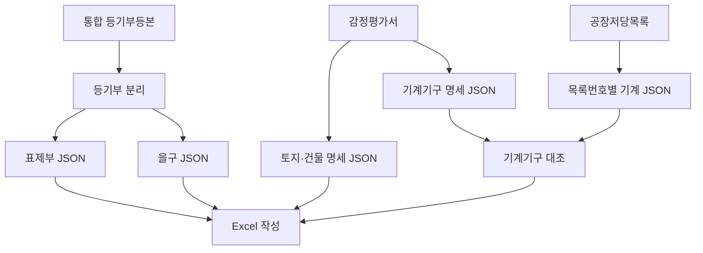

# 기계기구 담보물 배분표 자동화 프로젝트 명세

## 1. 프로젝트 목표

통합 등기부등본, 감정평가서, 공장저당목록을 각각 구조화된 JSON으로 변환한 뒤, 정해진 Excel 양식의 담보물 배분표와 기계기구 담보물 대조표를 자동 작성한다.

핵심은 다음 두 문서의 역할을 구분하고 연결하는 것이다.

- `datas/공장저당법목록.pdf`: **공장저당목록**: 실제로 어떤 기계기구가 각 저당목록에 포함되는지를 판단하는 기준 문서
- `datas/감정평가서 휴먼중공업.pdf` **감정평가서**: 각 기계기구의 일련번호와 평가금액을 판단하는 기준 문서

### 회사 감정평가서 형식설명
`harness/감정평가서_형식.md`

### 회사 저당목록 형식설명
`harness/공장저당목록_형식.md`

### 최종 엑셀형식
`harness/담보물배분표_엑셀양식_명세.md`

따라서 저당목록만으로는 담보물의 평가금액을 알 수 없으며, 감정평가서의 기계기구 감정평가명세표와 대조해야 최종 담보가치를 계산할 수 있다.

> **담보 포함 여부는 공장저당목록을 기준으로 하고, Excel 행의 일련번호와 평가금액은 감정평가서를 기준으로 한다.**

---

## 2. 전체 처리 구조



## 3. 현재 개발 상태

| 단계 | 입력 | 출력 | 상태 |
|---|---|---|---|
| 등기부 분리 | 통합 등기부등본 | 표제부·을구 문서 | 완료 |
| 표제부 추출 | 표제부 문서 | `title.json` | 완료 |
| 을구 추출 | 을구 문서 | `encumbrance.json` | 완료 |
| 감정평가서 추출 | 감정평가서 | 토지·건물 및 기계기구 JSON | 미구현 |
| 공장저당목록 추출 | 목록 문서 | 목록번호별 기계기구 JSON | 미구현 |
| 기계기구 대조 | 위 두 JSON | 매칭 결과 | 미구현 |
| Excel 작성 | 전체 JSON 및 매칭 결과 | 최종 배분표 | 일부 구현, 통합 필요 |

### 현재 완료된 JSON 구조

#### `output/{원본등기부등본이름}/title.json`

```json
{
  "registry_id": "등기부 식별값 또는 원본 경로",
  "property_type": "건물",
  "location": "부동산 소재지",
  "details": "구조·용도·면적 등 표제부 상세내용"
}
```

#### `output/{원본등기부등본이름}/encumbrance.json`

```json
{
  "registry_id": "등기부 식별값 또는 원본 경로",
  "mortgages": [
    {
      "registration": "설정일자",
      "maximum_claim": "채권최고액",
      "mortgagee": "근저당권자",
      "shared_collateral": "공동담보 여부",
      "mortgage_list_no": "공장 및 광업재단 저당법 제6조 목록 제2024-57호"
    }
  ]
}
```

`mortgages[].mortgage_list_no`가 Excel의 담보물 내역 및 대조표의 동적 목록 열을 생성하는 기준이다.

---

## 4. 문서별 기준 정보

| 정보 | 기준 문서 | 사용 목적 |
|---|---|---|
| 부동산 종류·소재지·내역 | 표제부 | 담보물 기본정보 |
| 설정일자·채권자·채권최고액 | 을구 | 배분표 권리정보 |
| 저당목록 번호 | 을구 | 목록별 열 생성 |
| 목록별 실제 담보 기계기구 | 공장저당목록 | 담보 포함 여부 판정 |
| 토지·건물 평가금액 | 감정평가서 | 부동산 가치평가 |
| 기계기구 일련번호 | 감정평가서 | 대조표 행 번호 |
| 기계기구 수량·단가·금액 | 감정평가서 | 기계기구 가치평가 |
| 기계기구 명칭·제작자·제작일자 | 양쪽 문서 | 동일 기계기구 대조 |

---

## 5. 감정평가서 처리

### 5.1 문서 구간 식별 원칙

페이지 번호는 문서마다 달라질 수 있으므로 사용하지 않는다. 제목, 표 머리글, 열 구조를 기준으로 다음 구간을 찾아야 한다.

- `토지·건물 감정평가명세표`
- `기계기구 감정평가명세표`

문서 전체를 하나의 표로 해석하지 말고, 위 두 구간을 분리하여 각각 구조화한다. 제목 표기가 조금 달라도 `감정평가명세표`라는 명칭과 내부 열 구조를 함께 사용해 판별한다.

### 5.2 감정평가서 JSON 초안

권장 파일명: `appraisal.json`

```json
{
  "schema_version": 1,
  "source_document": "감정평가서 식별값 또는 원본 경로",
  "land_building_items": [
    {
      "serial_no": "1",
      "property_type": "토지",
      "location": "원문 소재지",
      "details": "지목·용도·구조·면적 등",
      "quantity": null,
      "unit": "㎡",
      "unit_price": null,
      "appraised_value": 0,
      "remarks": null,
      "source_text": "해당 행 원문"
    }
  ],
  "machinery_items": [
    {
      "appraisal_serial_no": "1",
      "name": "기계기구 명칭 원문",
      "specification": "규격·형식·모델 원문",
      "manufacturer": "제작자 원문",
      "manufactured_date": "제작일자 원문",
      "quantity": 1,
      "unit": "식",
      "unit_price": 0,
      "appraised_value": 0,
      "remarks": null,
      "source_text": "해당 행 원문"
    }
  ],
  "validation": {
    "declared_total_value": null,
    "calculated_total_value": 0,
    "warnings": []
  }
}
```

### 5.3 추출 규칙

- `appraisal_serial_no`는 감정평가서에 기재된 일련번호를 그대로 저장한다.
- 명칭, 규격, 제작자, 제작일자는 서로 다른 열 또는 여러 줄에 걸쳐 있을 수 있으므로 하나의 품목 행으로 복원한다.
- 금액은 쉼표, `원`, 공백 등을 제거한 정수형 원 단위 값도 함께 확보한다.
- 감정평가서에 명시된 평가금액이 있으면 이를 우선한다.
- `수량 × 단가`는 검산에 사용한다. 명시 금액과 다르면 임의 수정하지 않고 경고를 남긴다.
- 표 안의 `합계`, `이하 여백`, 주석 행은 기계기구 품목으로 생성하지 않는다.
- OCR 결과가 불명확한 필드는 추정값으로 확정하지 말고 `null`과 경고를 사용한다.
- `source_text`에는 추출 근거가 된 원문을 보존한다.

---

## 6. 공장저당목록 처리

### 6.1 문서 구조

공장저당목록 문서는 다음 구조가 목록번호별로 반복될 수 있다.

```text
목록번호 A
├─ 목록 변경내역표
├─ 간지 또는 제6조 목록 표지
├─ 기계기구목록
└─ 부속 설명·확인 내용

목록번호 B
├─ 목록 변경내역표
├─ 간지 또는 제6조 목록 표지
├─ 기계기구목록
└─ 부속 설명·확인 내용
```

페이지가 아니라 **목록번호**를 최상위 분할 기준으로 사용한다. 새로운 목록번호가 나타나면 새 목록 묶음을 시작한다.

### 6.2 공장저당목록 JSON 초안

권장 파일명: `mortgage_assets.json`

```json
{
  "schema_version": 1,
  "source_document": "공장저당목록 식별값 또는 원본 경로",
  "mortgage_lists": [
    {
      "mortgage_list_no": "공장 및 광업재단 저당법 제6조 목록 제2024-57호",
      "status": "active",
      "machinery_items": [
        {
          "list_serial_no": "1",
          "name": "기계기구 명칭 원문",
          "specification": "규격·형식·모델 원문",
          "manufacturer": "제작자 원문",
          "manufactured_date": "제작일자 원문",
          "quantity": 1,
          "unit": "대",
          "remarks": null,
          "source_text": "해당 행 원문"
        }
      ],
      "change_history": [
        {
          "change_type": "addition",
          "effective_date": null,
          "target_serial_no": null,
          "description": "변경내역 원문"
        }
      ],
      "warnings": []
    }
  ]
}
```

### 6.3 추출 규칙

- `mortgage_list_no`는 을구의 `mortgage_list_no`와 비교할 수 있도록 전체 명칭을 보존한다.
- 동시에 비교용 정규화 값에서는 공백과 접두 문구 차이를 제거하고 `연도-번호`를 식별할 수 있어야 한다.
- 실제 담보물 정보는 각 목록번호에 속한 `기계기구목록`에서 추출한다.
- 목록의 일련번호는 `list_serial_no`로 저장하며 감정평가서 일련번호와 같은 번호라고 가정하지 않는다.
- 변경·추가·삭제 기록이 있으면 최종 유효 품목과 변경이력을 구분해 저장한다.
- 말소 또는 삭제된 품목을 현재 유효 품목에 자동 포함하지 않는다.
- 금액이 문서에 없으면 생성하거나 추정하지 않는다.
- `source_text`에는 해당 품목의 원문을 보존한다.

---

## 7. 기계기구 대조 로직

### 7.1 기준 행과 기준 열

- 대조표의 **한 행**은 감정평가서 `machinery_items[]`의 한 항목이다.
- 대조표의 **일련번호**는 `appraisal_serial_no`를 사용한다.
- 오른쪽의 **목록번호별 열**은 을구 `mortgages[].mortgage_list_no`를 기준으로 동적 생성한다.
- 동일 기계기구가 여러 저당목록에 포함될 수 있으므로 한 행에 여러 개의 `O`가 표시될 수 있다.

### 7.2 비교 필드

저당목록 항목과 감정평가서 항목을 다음 순서로 비교한다.

1. 명칭
2. 제작자
3. 제작일자
4. 규격·형식·모델
5. 수량
6. 양쪽 문서의 일련번호는 보조 단서로만 사용

일련번호 체계는 문서마다 다를 수 있으므로 번호가 같다는 이유만으로 동일 기계기구로 확정하면 안 된다.

### 7.3 정규화

- 한글·영문 앞뒤 공백 제거
- 연속 공백 축소
- 영문 대소문자 통일
- 일반적인 구두점 및 단위 표기 통일
- 날짜를 가능한 경우 `YYYY-MM` 또는 `YYYY-MM-DD`로 통일
- 제작자 법인 표기와 약칭은 원문과 정규화 값을 모두 보존
- 모델명, 숫자, 용량, 규격은 과도하게 제거하지 않음

### 7.4 판정 상태

| 상태 | 의미 | Excel 출력 |
|---|---|---|
| `matched` | 동일 기계기구로 확정 | `O` |
| `probable` | 유력하지만 일부 정보 누락 | 검토 후 `O` |
| `unmatched` | 핵심 정보가 충돌하거나 대상 없음 | 빈칸 |
| `ambiguous` | 복수 후보 또는 OCR 오류로 판단 불가 | 빈칸 및 검토 경고 |

`probable`과 `ambiguous`를 LLM이 임의로 확정하지 않도록 하며, 판단 근거를 남겨야 한다.

### 7.5 중간 매칭 결과 JSON

권장 파일명: `machinery_matches.json`

```json
{
  "schema_version": 1,
  "rows": [
    {
      "appraisal_serial_no": "1",
      "appraisal_item": {
        "name": "기계명",
        "manufacturer": "제작자",
        "manufactured_date": "2020-01",
        "quantity": 1,
        "unit_price": 1000000,
        "appraised_value": 1000000
      },
      "mortgage_memberships": [
        {
          "mortgage_list_no": "공장 및 광업재단 저당법 제6조 목록 제2024-57호",
          "status": "matched",
          "list_serial_no": "3",
          "matched_fields": [
            "name",
            "manufacturer",
            "manufactured_date"
          ],
          "conflicting_fields": [],
          "reason": "명칭·제작자·제작일자 일치"
        }
      ]
    }
  ],
  "unmatched_appraisal_items": [],
  "unmatched_mortgage_items": [],
  "warnings": []
}
```

이 중간산출물은 LLM의 판단 결과를 사람이 검토하고, Excel 생성 로직을 LLM과 분리하기 위해 필요하다.

---

## 8. Excel 작성 규칙

## 8.1 기계기구 담보물 대조표

### 고정 열

- 일련번호
- 명칭
- 제작자
- 제작일자
- 수량
- 단가
- 금액

고정 열 값은 감정평가서의 기계기구 감정평가명세표를 기준으로 작성한다.

### 동적 열

- 을구에서 추출한 유효한 `mortgage_list_no` 개수만큼 오른쪽에 열을 추가한다.
- 목록번호가 6개이면 6열, 8개이면 8열을 생성한다.
- 같은 목록번호가 여러 을구 항목에 반복되면 중복 열을 만들지 않는다.
- 을구의 순위 또는 등장 순서를 유지한다.
- 매칭 상태가 `matched`인 경우 해당 셀에 `O`를 입력한다.
- 자동 확정되지 않은 상태는 빈칸으로 두고 검토 경고에 남긴다.

### 금액

- 각 행의 금액은 감정평가서의 명시 평가금액을 우선한다.
- 명시 평가금액이 없고 수량과 단가가 모두 신뢰 가능할 때만 `수량 × 단가`를 사용한다.
- 합계는 대조표에 포함된 감정평가 항목 금액의 합으로 계산한다.

## 8.2 기계기구 담보물 배분표

### 담보물 내역

을구에서 확보된 목록번호를 순위별로 표시한다.

```text
기계기구 N식
1순위: 공장 및 광업재단 저당법 제6조 목록 제XXXX-XX호
2순위: 공장 및 광업재단 저당법 제6조 목록 제XXXX-XX호
```

`N식`은 감정평가서 항목 수를 무조건 사용하지 말고, 현재 Excel 양식에서 요구하는 집계 단위와 유효 매칭 품목 수를 확인해 결정한다.

### 가치평가액

- 기계기구 가치평가액은 대조가 완료된 감정평가서 항목의 평가금액을 기반으로 계산한다.
- 동일 기계기구가 여러 목록에 포함되어도 전체 기계기구 총액에서 중복 합산하지 않는다.
- 순위별 또는 목록별 담보가치를 따로 계산할 때는 각 목록 열에 `O`가 있는 행만 합산한다.

### 권리·배분 정보

- 순위, 설정일자, 채권자, 공동담보 여부, 채권최고액은 을구에서 가져온다.
- 배분액과 배분잔액은 기존 배분 계산 규칙에 따라 계산한다.
- 매칭 불확실 항목은 자동 배분에 포함하지 않거나 별도 검토 정책을 적용한다.

---

## 9. LLM과 일반 코드의 책임 분리

### LLM이 담당할 작업

- 문서의 논리적 구간 식별
- 여러 줄에 걸친 표 행 복원
- OCR 표기 차이를 고려한 필드 추출
- 감정평가서 항목과 저당목록 항목의 의미 기반 후보 매칭
- 매칭 근거와 불확실성 반환

### 일반 코드가 담당할 작업

- JSON Schema 검증
- 숫자·날짜·목록번호 정규화
- 합계 및 `수량 × 단가` 검산
- 목록번호 중복 제거와 열 순서 결정
- Excel 행·열 삽입, 병합, 서식 복제
- `O` 표시 및 금액 합산
- 배분액 계산
- 오류·경고 보고서 생성

LLM이 Excel 셀 위치를 직접 결정하거나 최종 금액을 자유롭게 계산하게 하지 않는다. LLM은 구조화된 중간산출물을 만들고, Excel 작성은 결정적 코드로 수행한다.

---